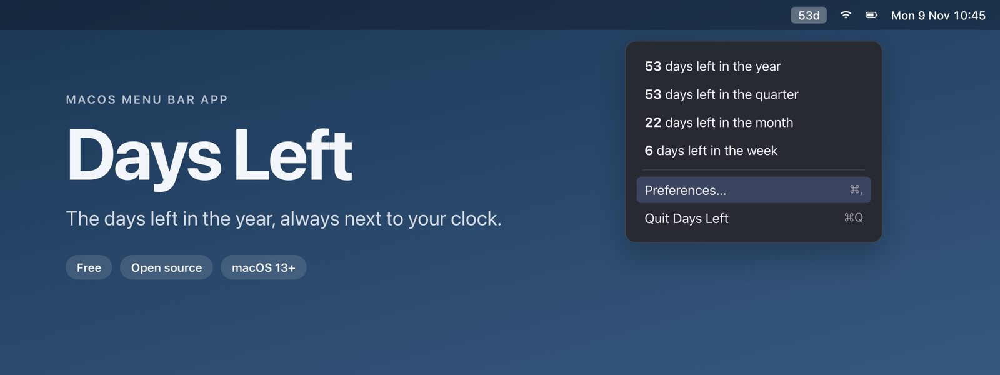
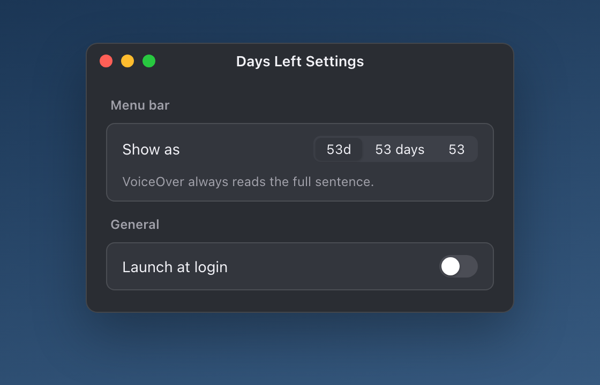

<p align="center">
  
</p>

<h3 align="center">Know how much of the year is left without opening a calendar.</h3>

<p align="center">
  One number sits next to your clock. Click it for the quarter, month and week.
</p>

<p align="center">
  <a href="../../releases/latest"></a>
</p>

<p align="center">
  
  
  
  <a href="LICENSE"></a>
</p>

<p align="center">
  <a href="#-install"><strong>Install</strong></a> ·
  <a href="#%EF%B8%8F-make-it-yours"><strong>Settings</strong></a> ·
  <a href="#-good-to-know"><strong>Good to know</strong></a> ·
  <a href="#%EF%B8%8F-development"><strong>Development</strong></a>
</p>

## 📅 What it shows

| Where | On Mon 9 Nov 2026 |
|---|---|
| Menu bar | `53d` |
| Year | 53 days left in the year |
| Quarter | 53 days left in the quarter |
| Month | 22 days left in the month |
| Week | 6 days left in the week |

Every count includes today, so the last day of a month reads **1 day left**, and on Dec 31 the year, quarter and month all read 1.

## ⚡ Install

**Let your coding agent do it.** Paste this into Claude Code, Codex, Cursor or Gemini CLI:

```text
Install the latest Days Left release by following https://github.com/Devansh-365/daysleft/blob/main/skills/install-days-left/SKILL.md
```

**Or do it yourself:**

1. Download `DaysLeft-v1.1.0.dmg` from the [latest release](../../releases/latest).
2. Open it and drag **Days Left** into Applications.
3. Launch it. If macOS blocks it, right-click the app and choose **Open**. The app isn't notarized yet.

Terminal commands, checksum checks, building from source and uninstalling are in [docs/install.md](docs/install.md).

## 🎛️ Make it yours



Open **Preferences…** from the dropdown, or press **⌘,**.

- **Show as** `53d`, `53 days` or just `53`.
- **Launch at login** is off until you switch it on. The app never adds itself.
- **⌘Q** quits, and **⌘W** closes the Settings window.

<br clear="right">

## 💡 Good to know

- **Updates on its own** at midnight, after sleep, and when the clock or time zone changes.
- **VoiceOver** reads the menu bar item as "53 days left in the year".
- **Stays out of the way.** It has no Dock icon, sends no notifications and makes no network requests.

## 🛠️ Development

```bash
make build   # debug build
make test    # unit tests
make dmg     # universal, signed DMG for a release
```

The code is split into `app/`, `state/`, `views/`, `services/`, `models/` and `utilities/`. Release notes are in [CHANGELOG.md](CHANGELOG.md), and [CONTRIBUTING.md](CONTRIBUTING.md) explains how to send a change.

## 📄 License

[MIT](LICENSE), by Devansh Tiwari.

<p align="center">
  <sub>If it saves you a trip to the calendar, a ⭐ helps other people find it.</sub>
</p>
